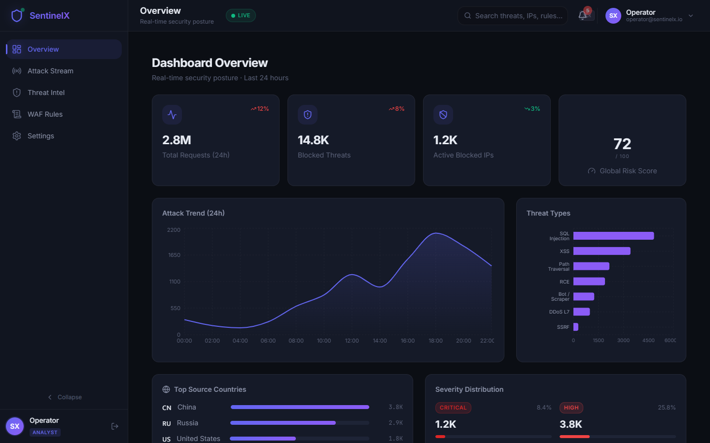
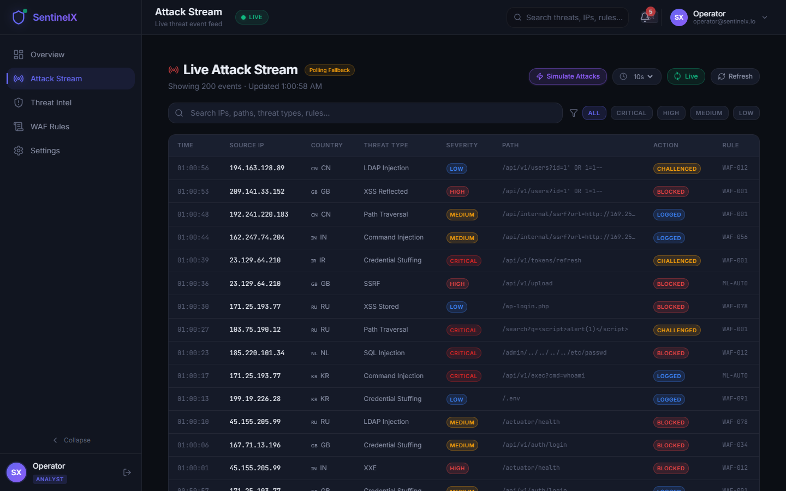
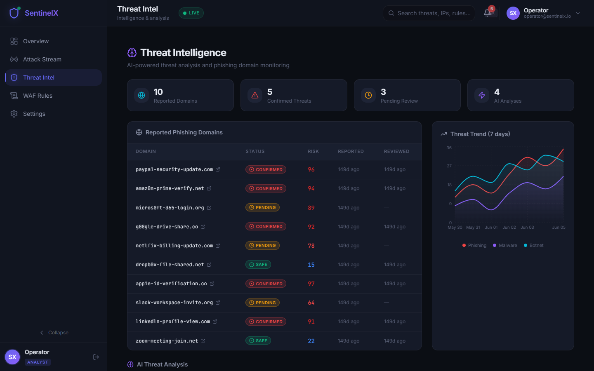

# 🛡️ SentinelX

**Open Source Web Security Platform — WAF Engine, AI Threat Analysis, and Real-Time SOC Dashboard**

<div align="center">


</div>

SentinelX is a full-stack cybersecurity platform that combines a high-performance Web Application Firewall (WAF), asynchronous AI-powered threat analysis, a browser security extension, and a beautiful real-time SOC dashboard — all open source.

---

## 📸 Interface Showcase

### 1. Real-Time SOC Dashboard & Threat Telemetry
*Global risk scoring, live request volume, 24h threat trends, and top attack category distributions.*



### 2. Live Attack Stream & Event Correlation
*Granular real-time packet inspection, threat classification, IP reputation badges, and mitigation actions.*



### 3. Threat Intelligence Hub & AI Summaries
*Multi-source threat aggregation (VirusTotal, AbuseIPDB, OpenPhish) with automated AI incident analysis.*



---

## 🏗️ Architecture

```
┌────────────────────────────────────────────────────────────────┐
│                      Browser Layer                             │
│  ┌───────────────┐                    ┌───────────────────┐    │
│  │  SecureLens    │                    │   SOC Dashboard   │    │
│  │  Extension     │                    │   React 19 / TS   │    │
│  │  Manifest V3   │                    │   TailwindCSS v4  │    │
│  └───────┬───────┘                    └────────┬──────────┘    │
│          │ Report Threats                      │ REST API      │
└──────────┼─────────────────────────────────────┼───────────────┘
           │                                     │
┌──────────┼─────────────────────────────────────┼───────────────┐
│          ▼                                     ▼               │
│  ┌─────────────────────────────────────────────────────────┐   │
│  │              WAF ASGI Middleware                         │   │
│  │  Whitelist → Blacklist → Rate Limit → GeoIP → Rules     │   │
│  └────────────────────────┬────────────────────────────────┘   │
│                           │                                     │
│  ┌────────────────────────▼────────────────────────────────┐   │
│  │              FastAPI Application                         │   │
│  │  Auth │ Users │ WAF Logs │ Threats │ Dashboard           │   │
│  └───┬────────┬────────────┬───────────────────────────────┘   │
│      │        │            │                                    │
│  ┌───▼───┐ ┌──▼───┐ ┌─────▼──────┐    ┌───────────────────┐   │
│  │  PG   │ │Redis │ │Elasticsearch│    │  Celery Workers   │   │
│  │ ACID  │ │Cache │ │  Logs      │    │  AI + Intel       │   │
│  └───────┘ └──────┘ └────────────┘    └───────────────────┘   │
└────────────────────────────────────────────────────────────────┘
```

---

## ✨ Features

### 🔥 WAF Engine
- **YAML-based rule definitions** — Sigma-like syntax for easy customization
- **12+ pre-built detection rules** — SQL injection, XSS, path traversal, command injection
- **5-step middleware pipeline** — Whitelist → Blacklist → Rate Limit → GeoIP → Rule Engine
- **Redis sliding-window rate limiter** — Per-IP, per-endpoint rate limiting
- **IP reputation system** — Auto-block after configurable threat threshold
- **Zero-copy request inspection** — Non-blocking async design

### 🤖 AI Threat Analysis
- **Multi-provider LLM support** — OpenAI, Anthropic, Ollama (local)
- **Structured threat reports** — Classification, severity, impact, mitigations
- **Heuristic fallback** — Full analysis even without LLM API keys
- **Never blocks HTTP path** — Always dispatched via Celery workers

### 🔍 Threat Intelligence
- **VirusTotal integration** — Domain reputation lookups
- **AbuseIPDB integration** — IP abuse confidence scoring
- **OpenPhish feed** — Phishing domain detection
- **Aggregate risk scoring** — Weighted multi-source intelligence

### 🌐 SecureLens Browser Extension
- **Manifest V3 compliant** — Service workers, declarative rules
- **Real-time security scoring** — SSL, headers, cookies, URL analysis
- **Technology fingerprinting** — Detects React, Vue, Angular, WordPress, etc.
- **Threat reporting** — Report suspicious sites to SentinelX API
- **Dark SOC-themed popup** — Beautiful security analysis interface

### 📊 SOC Dashboard
- **Overview** — KPI metrics, risk gauge, attack trend charts
- **Live Attack Stream** — Real-time threat feed with filtering & pagination
- **Threat Intel Hub** — Domain analysis, AI summaries, trend visualization
- **WAF Rules Manager** — Enable/disable rules, category filtering
- **Settings** — Profile, API config, WAF tuning, notifications

---

## 🚀 Quick Start

### Prerequisites
- [Node.js 22+](https://nodejs.org/) (for dashboard)
- [Python 3.13+](https://python.org/) (for API)
- [Docker](https://docker.com/) (for full stack)

### Dashboard Only (Standalone)

```bash
cd dashboard
npm install
npm run dev
# → http://localhost:5173
```

> The dashboard includes realistic mock data — no backend needed to explore the UI.

### Full Stack (Docker Compose)

```bash
# 1. Configure environment
cp .env.example .env
# Edit .env with your database credentials, API keys, etc.

# 2. Start all services
docker compose up -d

# 3. Access
# API:       http://localhost:8000
# Dashboard: http://localhost:3000
# Swagger:   http://localhost:8000/docs
```

### Browser Extension

1. Open `chrome://extensions` or `edge://extensions`
2. Enable **Developer mode**
3. Click **Load unpacked** → select the `extension/` directory
4. Navigate to any website to see the security analysis

---

## 📁 Project Structure

```
sentinelx/
├── api/                        # FastAPI Backend
│   ├── core/                   # Config, DB, Security, Redis, ES
│   ├── models/                 # SQLAlchemy 2.0 models (7 tables)
│   ├── schemas/                # Pydantic v2 validation schemas
│   ├── repositories/           # Data access layer
│   ├── services/               # Business logic
│   ├── routes/                 # API endpoints
│   ├── workers/                # Celery tasks (AI, Intel)
│   └── tests/                  # Test suite
│
├── waf/                        # WAF Engine
│   ├── rules/                  # YAML detection rules
│   ├── detectors/              # Heuristic detection modules
│   ├── engine.py               # Rule evaluation engine
│   ├── middleware.py           # ASGI middleware
│   ├── rate_limiter.py         # Redis rate limiter
│   └── ip_manager.py           # IP blacklist/whitelist
│
├── dashboard/                  # React SOC Dashboard
│   ├── src/
│   │   ├── components/         # Sidebar, Header, Layout
│   │   ├── pages/              # Overview, Attacks, Threats, Rules, Settings
│   │   ├── stores/             # Zustand auth store
│   │   ├── lib/                # API client (Axios)
│   │   └── types/              # TypeScript definitions
│   └── vite.config.ts
│
├── extension/                  # SecureLens Browser Extension
│   ├── manifest.json           # Manifest V3
│   ├── background/             # Service worker
│   ├── content/                # Content script
│   └── popup/                  # Popup UI + options
│
├── deploy/                     # Production deployment
│   ├── nginx.conf              # Production nginx config
│   └── deploy.sh               # Deploy script
│
├── .github/workflows/ci.yml    # CI/CD pipeline
├── docker-compose.yml          # Full stack orchestration
└── .env.example                # Environment template
```

---

## 🔧 Tech Stack

| Component | Technology |
|-----------|-----------|
| **API** | Python 3.13, FastAPI (async), SQLAlchemy 2.0, Pydantic v2 |
| **Database** | PostgreSQL (ACID), Redis (cache/rate limit), Elasticsearch (logs) |
| **Workers** | Celery + Redis broker |
| **AI/ML** | OpenAI / Anthropic / Ollama (configurable) |
| **Dashboard** | React 19, TypeScript, Vite, TailwindCSS v4, Recharts |
| **State** | Zustand (client), TanStack Query v5 (server) |
| **Extension** | Chrome/Edge Manifest V3 |
| **DevOps** | Docker Compose, GitHub Actions CI/CD |

---

## 🧪 WAF Detection Coverage

| Category | Rules | Techniques Detected |
|----------|:-----:|---------------------|
| SQL Injection | 4 | UNION, Boolean Blind, Stacked Queries, Comment Evasion |
| XSS | 4 | Script Tags, Event Handlers, JavaScript Protocol, HTML Injection |
| Path Traversal | 2 | Directory Traversal, Sensitive File Access |
| Command Injection | 2 | Shell Metacharacters, System Commands |

Rules are defined in YAML and can be easily extended:

```yaml
rules:
  - id: "SQLI-001"
    name: "SQL Injection - UNION SELECT"
    category: "sqli"
    severity: "critical"
    action: "block"
    conditions:
      match_type: "regex"
      targets: ["query_params", "body", "path"]
      patterns:
        - "(?i)(union\\s+(all\\s+)?select)"
```

---

## 🔐 API Authentication

SentinelX uses JWT with hierarchical RBAC:

| Role | Permissions |
|------|-------------|
| `admin` | Full access — manage users, rules, settings |
| `analyst` | View + write — manage threats, view logs |
| `viewer` | Read-only — view dashboards and reports |

```bash
# Login
curl -X POST http://localhost:8000/api/v1/auth/login \
  -H "Content-Type: application/json" \
  -d '{"email": "admin@sentinelx.io", "password": "sentinelx-admin"}'
```

---

## 🧪 Testing

```bash
# Run WAF engine tests
cd sentinelx
python -m pytest api/tests/ -v

# Test specific detection
python -m pytest api/tests/test_core.py::TestWAFEngine::test_sqli_detection -v
```

---

## 🤝 Contributing

1. Fork the repository
2. Create a feature branch (`git checkout -b feature/amazing-feature`)
3. Commit your changes (`git commit -m 'Add amazing feature'`)
4. Push to the branch (`git push origin feature/amazing-feature`)
5. Open a Pull Request

---

## 📄 License

This project is licensed under the MIT License — see the [LICENSE](LICENSE) file for details.

---

<div align="center">
  <sub>Built with ❤️ for the security community</sub>
</div>
